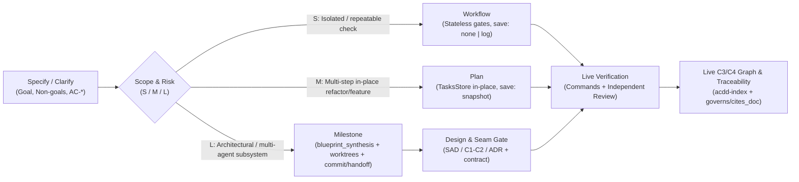

# Specification, Design, and Verification Lifecycle

ContextUnity ACDD separates problem definition (**Specify / Clarify**), architectural framing (**Design**), and automated proof (**Execution & Verification**), sizing ceremony to the scope of change (**S / M / L**) while keeping low-level component and code diagrams grounded in the live indexed AST graph.

> [!NOTE]
> Live runtime boundaries are documented in [Architecture index](README.md) and [ACDD execution reference](../reference/acdd.md). Extensions for the builtin `author-spec` workflow, `ac_mapping` and `c2_boundary_impact` blueprint properties, optional `spec:`/`acceptance_criteria:` bundle projection, unified SQLite `Plan` execution, and `inherit: workspace` resource sharing are tracked in [`AC-004-unified-execution-and-spec-pipeline`](../milestones/AC-004-unified-execution-and-spec-pipeline.md).

## Specify / Clarify before implementation

Ambiguous requirements cause rework faster than syntax bugs. Before choosing code edits or task boundaries, specification artifacts establish three explicit contracts:

1. **Goal**: The concrete outcome or capability being introduced or changed.
2. **Non-goals**: Adjacent behaviors, integrations, or optimizations explicitly excluded from scope.
3. **Ambiguities and Acceptance Criteria (`AC-*`)**: Edge cases, failure semantics, security boundaries, and testable numbered assertions (`AC-1`, `AC-2`, ...) against which reviewers and seam tests verify completion.

Product requirements or feature specifications (`docs/specs/*.md` or inline specification blocks in a Plan/Milestone manifest) remain concise behavioral authorities rather than implementation walkthroughs.

## Design artifacts: SAD, ADRs, and live C4

ACDD treats architectural documentation as a multi-resolution hierarchy where humans author high-level boundaries and the indexer maintains structural truth:

| Layer | Authoring Owner | Purpose in ACDD |
| :--- | :--- | :--- |
| **PRD / Spec (`AC-*`)** | Product / Architect | Defines `Goal`, `Non-goals`, edge cases, and testable acceptance criteria. |
| **C4 Level 1 & 2 + SAD** | Architect (`docs/architecture/`) | Captures external actors, system context (`C1`), container/crate boundaries (`C2`), data flows, and `INV-*` invariants. |
| **ADRs** | Architecture Owner (`docs/adr/`) | Records durable present-tense architectural trade-offs and superseded boundaries ([ADR index](../adr/README.md)). |
| **C4 Level 3 & 4** | Live Index (`acdd-index`) | Derived automatically from AST parsing and symbol linking (`code_map_overview`, `code_map_inspect`, `code_map_impact`, `code_map_query`) so component and symbol maps never drift from source. |

Static Markdown documentation stops at **C4 Level 1–2** and invariant definitions (`INV-*`). Detailed call graphs, dependency edges, and symbol signatures come directly from the SQLite code map (`governs` and `cites_doc` edges linking documentation claims to uniquely resolved declarations).

## S / M / L right-sizing cadence

Every initiative maps to the lightest ACDD lifecycle model defined in [ADR 0021](../adr/0021-workflow-plan-and-milestone-lifecycle-hierarchy.md) that preserves verification integrity:

- **Small (`S`) -> `Workflow`**: Single-purpose standalone or repeatable procedures (CI checks, penetration tests, security audits, repository cleanups, authoring workflows). Uses pure `gates:` with `inherit: none` (isolated sandbox) or `inherit: workspace` (shared repository roles and commands), `save: none | log`, and zero `tasks.sqlite` rows.
- **Medium (`M`) -> `Plan`**: Coherent multi-step changes on the active working tree (`docs/plans/*.md`) with clear `AC-*` targets, ordered steps and subtasks, `save: snapshot`, and independent review—without requiring `blueprint_synthesis`, red `contract` tests, or branch handoff.
- **Large (`L`) -> `Milestone`**: Architectural or concurrent multi-task changes (`docs/milestones/*.md`) requiring pre-task `blueprint_synthesis` (`synthesize` -> `review`, mapping `AC-*` criteria, `C2` boundary impact, `ADR` requirements, and `SAD` updates into per-task slices), isolated Git worktrees, runtime-red `contract` tests, conditional `seam` integration, and bound `handoff` archival.

## Governance invariants

> [!IMPORTANT]
> Invariant: Live source indexes (`acdd-index`) remain the sole authority for C4 Level 3–4 component and code dependency graphs; static architecture documents declare C1–C2 boundaries and `INV-*` rules without duplicating mutable symbol catalogs. [`extract_with_details`](../../crates/acdd-index/src/docs.rs)

> [!IMPORTANT]
> Invariant: Milestone `blueprint_synthesis` gates commit architectural boundaries (`proofs.blueprint`) to `gate_transitions` before task claiming (`MILESTONE_PRE_TASK_GATE_PENDING`), isolating each task's `context_bundle` to its own contract slice. [`preflight_milestone_init`](../../crates/acdd-tasks/src/milestones/synthesis.rs)
